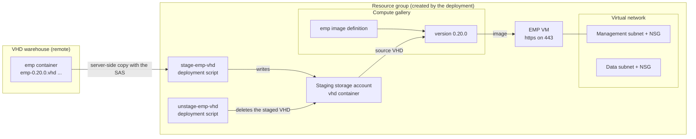

# EMP deployment

Deploys EMP, the deployer and management front end for Nectere DS (FileDS and
BlockDS), into a resource group: the network the clusters will use, a compute
gallery with the EMP image taken from the VHD warehouse, and the EMP virtual
machine. When it finishes, EMP is waiting for its first sign-in in the browser.

**[Deploy to Azure](https://portal.azure.com/#create/Microsoft.Template/uri/https%3A%2F%2Fraw.githubusercontent.com%2Fpipefl%2Fnds-deploy%2Fmain%2Farm%2FmainTemplate.json/createUIDefinitionUri/https%3A%2F%2Fraw.githubusercontent.com%2Fpipefl%2Fnds-deploy%2Fmain%2Fui%2FcreateUiDefinition.json)**

```
https://portal.azure.com/#create/Microsoft.Template/uri/https%3A%2F%2Fraw.githubusercontent.com%2Fpipefl%2Fnds-deploy%2Fmain%2Farm%2FmainTemplate.json/createUIDefinitionUri/https%3A%2F%2Fraw.githubusercontent.com%2Fpipefl%2Fnds-deploy%2Fmain%2Fui%2FcreateUiDefinition.json
```

The first line of the form shows the template version, e.g.
`Template version: 20261028210000`.

---

## What gets deployed

In the resource group you pick:

- A virtual network with a management subnet and a data subnet, each with its
  own NSG attached to the subnet. Or an existing network, used as it is.
- A staging storage account that the EMP VHD is
  copied into from the warehouse. Azure builds gallery images only from a VHD
  in the same subscription. The staged copy is deleted at the end; the empty
  account stays for the next run.
- A compute gallery (`<name>_gal`) with the image definition `emp` and one
  version, e.g. `0.20.0`. Its delete protection is off, so the version can be
  removed like any other resource. EMP adds the FileDS and
  BlockDS controller images to the same gallery later.
- The EMP VM: Ubuntu with EMP and its performance collector in Docker, a static
  private IP on the management subnet (host 50 by default), a public IP if you
  ask for one, managed boot diagnostics. No NSG on its NIC.

Two deployment scripts (`<name>-stage-emp-vhd`, `<name>-unstage-emp-vhd`) do the copying.
Each runs in a short-lived container instance with its own temporary storage,
both removed when the script succeeds. They use the staging account's key and
your SAS. They need no managed identity and no role assignments.

### How it fits together



The deployment takes 15 to 30 minutes, most of it the copy and the image
version. The copy is quickest when the resource group is in the warehouse's
region (East US).

---

## Before you start

### The SAS token

Ask for a SAS on the warehouse with **read** and **list** on the `emp`
container. Paste it with or without the leading `?`. It is a secure parameter:
it is not shown in the deployment's inputs, and the deployment script gets it
as a secure environment variable.

### Who runs the deployment

**Contributor** on the subscription, or on the resource group if it already
exists. The deployment creates no role assignments.

The subscription needs the `Microsoft.ContainerInstance` resource provider
registered, because deployment scripts run in container instances. Most
subscriptions have it. To check, and register it if needed:

```bash
az provider show -n Microsoft.ContainerInstance --query registrationState -o tsv
az provider register -n Microsoft.ContainerInstance
```

A policy that turns off shared key access on storage accounts stops the
deployment scripts. So does a policy that forbids public network access on
storage.

### Region and quota

FileDS and BlockDS data disks are Premium SSD v2. Put EMP in a region that has
it if the clusters go in the same region (EMP can also deploy into other
regions). The first page of the form shows the region's free Ebdsv5 vCPU
quota. A cluster of three E8bds_v5 controllers needs 24.

---

## The form

### Basics

| Form field | Example | Notes |
|---|---|---|
| Deployment name | `fds1` | 3-12 lowercase letters, numbers and hyphens. The prefix for every resource |
| Subscription | `contoso-storage-01` | |
| Resource group | `rg-fds-prod` | Create new, or an existing one |
| Region | `East US` | The free Ebdsv5 vCPU quota shows below once picked |
| Storage account name | `nds10192026` | The VHD warehouse |
| SAS token | `sv=2026-02-06&ss=b&srt=co&sp=rl&se=...&sig=...` | Read and list on the `emp` container |

### Networking

| Form field | Example | Notes |
|---|---|---|
| Virtual network | Create new: `fds1-vnet`, `10.30.0.0/16` | Or an existing network in the region, with its existing subnets |
| Management subnet | `fds1-mgmt`, `10.30.0.0/24` | /26 or larger |
| Data subnet | `fds1-data`, `10.30.1.0/24` | /26 or larger |
| Allow access from | `203.0.113.7` | Your public IP, a CIDR, or several separated by commas. New network only |
| Give EMP a public IP address | ticked | Untick when EMP is reached over VPN or peering |
| EMP private IP | *(blank)* | Blank gives host 50 of the management subnet |

### EMP virtual machine

| Form field | Example | Notes |
|---|---|---|
| Size | `Standard_B2ms` | 2 vCPUs and 8 GiB are enough |
| Username | `fdsadmin` | The Linux user. EMP's own sign-in is made in the browser |
| Authentication type | Password or SSH public key | With a key, password login is off |

### Names

For deployment name `fds1`:

| Resource | Name |
|---|---|
| EMP VM, NIC, public IP, OS disk | `fds1-emp`, `fds1-emp-nic`, `fds1-emp-pip`, `fds1-emp-os` |
| Virtual network and subnets (new) | `fds1-vnet`, `fds1-mgmt`, `fds1-data` (defaults, can be changed in the form) |
| NSGs (new network only) | `fds1-mgmt-nsg`, `fds1-data-nsg` |
| Compute gallery | `fds1_gal`, image definition `emp` |
| Staging storage account | `fds1st` plus a hash of the resource group |
| Deployment scripts | `fds1-stage-emp-vhd`, `fds1-unstage-emp-vhd` |

The EMP image is always the newest `emp-<version>.vhd` in the warehouse's
`emp` container.

### NSG rules on a new network

"Inside" is the network's address space.

| NSG | Priority | Rule | From | Ports |
|---|---|---|---|---|
| mgmt | 100 | admin-ssh-https | inside | TCP 22, 443 |
| mgmt | 110 | admin_any_in | Allow access from | any |
| mgmt | 115 | cluster-store-and-relay | management subnet | TCP 2379-2380, 443 |
| mgmt | 120 | mgmt-name-dns | inside | 53 |
| data | 100 | smb-nfs | inside | TCP 2049, 445 |
| data | 105 | nes-peer-rpc | data subnet | TCP 7400 |
| data | 110 | admin_any_in | Allow access from | any |
| data | 115 | namespace-dns | inside | 53 |
| data | 120 | iscsi | inside | TCP 3260 |

With an existing network nothing is changed. EMP needs 443 in from wherever
you open it, and 22 and 443 to the controllers' management addresses.

---

## After the deployment

The deployment's **Outputs** has `empUrl`, `nextSteps` and
`servicePrincipalCommand`.

1. Open `empUrl`. EMP needs a few minutes after first boot. The certificate is
   self-signed until you install one under Settings. Create the EMP admin.
2. **Settings > Azure connection** needs a service principal with Contributor
   on the resource group EMP deploys clusters into. In Cloud Shell:

   ```bash
   az ad sp create-for-rbac --name fds1-emp-sp --role Contributor \
     --scopes /subscriptions/<subscription id>/resourceGroups/rg-fds-prod
   ```

   Enter `tenant`, `appId` and `password` from its output, and the
   subscription ID.
3. **Settings > Gallery > New gallery from VHDs**: storage account
   `nds10192026`, container `fileds` (or `blockds`), a SAS with read and list
   on it, and the gallery this deployment made. This adds the controller images
   to the gallery.
4. **New deployment**: the network and the two subnets from this deployment,
   the newest controller image.

EMP updates itself from its container registry (`sudo emp-update` on the VM),
so the image version only matters for the first boot.

---

## Deploying again

Running it again over the same resource group with the same values is safe.
The network, gallery and VM are updated to what the form says, which is what
they already are. The VHD is copied again (a few minutes) unless the staged
copy is still there, and an image version that already exists is left as it
is.

**If the image version fails** with a message that the source blob is not
accessible, deploy again. Azure sometimes refuses a VHD right after the copy
finishes, and the second build goes through. The staged copy is kept until a
version succeeds, so the second run does not copy again.

## Removing it

Delete the resource group. To keep the network, delete the VM (its disk, NIC
and public IP go with it), the gallery and the staging account.

---

## Building the template

`arm/mainTemplate.json` is built from `arm/main.bicep`, which embeds
`scripts/stage-vhd.sh`. After changing either:

```bash
az bicep build --file arm/main.bicep --outfile arm/mainTemplate.json
```

Bump the template version in `ui/createUiDefinition.json` (`yyyyMMddHHmmss`).

To try the form without deploying, paste `ui/createUiDefinition.json` into the
[CreateUiDefinition sandbox](https://portal.azure.com/#view/Microsoft_Azure_CreateUIDef/SandboxBlade).
